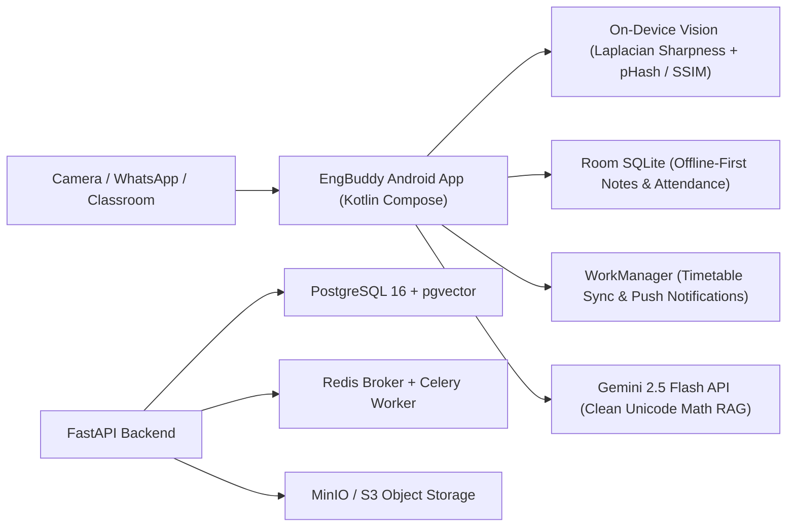

# EngBuddy (v2.0): The Ultimate Engineering Student Companion

An AI-powered assistant engineered for students to survive and excel in engineering:
- 📱 **Native Android Client:** Kotlin + Jetpack Compose with Liquid Glass aesthetics, on-device blur/pHash computer vision, Room SQLite database, and automated background timetable notifications via `WorkManager`.
- ⚡ **Async FastAPI Backend:** Python 3.12, pgvector HNSW similarity search, Celery + Redis worker pool for background PDF stitching, and Google OAuth2 integration.
- 🤖 **Clean Unicode Math AI:** Powered by Google Gemini 2.5 Flash with strict formatting prompts rendering clean UTF-8 symbols (`∫`, `∂`, `∑`, `√`, `α`, `β`, `²`) with zero raw LaTeX backslash clutter.

---

## Architecture Overview



---

## Quick Start: Running the Android App

### Prerequisites
* Java 17+ or Java 21 (JDK)
* [Android Studio](https://developer.android.com/studio) or Android SDK with Platform 36

### Steps
1. **Configure Environment Secrets:**
   Copy `.env.example` to `.env` and set your Gemini API key:
   ```bash
   cp .env.example .env
   ```
   Add your Gemini API key:
   ```env
   GEMINI_API_KEY=your_actual_gemini_api_key_here
   ```

2. **Run Tests with the Gradle Wrapper:**
   ```bash
   ./gradlew :app:testDebugUnitTest
   ```

3. **Install & Run on Device or Emulator:**
   Open this project directory in Android Studio and press **Run (Shift + F10)**, or run from the command line:
   ```bash
   ./gradlew :app:installDebug
   ```

---

## Quick Start: Running Backend & Cloud Services (Docker)

To spin up the entire cloud ecosystem locally (PostgreSQL 16 with `pgvector`, Redis 7, MinIO S3 storage, FastAPI, and Celery):

```bash
# 1. Start all containerized services
docker compose up -d

# 2. Seed default engineering user and subjects
docker compose exec backend python -m app.db.seed

# 3. Check health
curl http://localhost:8000/healthz
```

* **API Docs (Swagger UI):** `http://localhost:8000/docs`
* **MinIO Console:** `http://localhost:9001` (user: `minioadmin`, pass: `minioadmin`)

---

## Core Features & Blueprint Capabilities

1. **Intelligent Note Pipeline & Vault:**
   - On-device blur score using discrete Laplacian variance (`BLUR_THRESHOLD = 85.0`).
   - Deduplication via 64-bit difference hash (dHash), perceptual hash (pHash), and SSIM.
   - Timetable-aware auto-filing (e.g. defaulting Tuesday 10:15 AM notes to *Thermodynamics*).
   - 30-day automatic trash retention and restore capability.
2. **Interactive Bunk Horizon & Attendance Manager:**
   - Exact mathematical safe-bunk formula:
     $$\text{Safe Bunks} = \left\lfloor \frac{\text{Attended} - (0.75 \times \text{Total})}{0.75} \right\rfloor$$
   - Recovery class formula:
     $$\text{Classes Needed} = \left\lceil \frac{(0.75 \times \text{Total}) - \text{Attended}}{0.25} \right\rceil$$
   - Zero-app-open interactive notification buttons (`[✅ Yes, Attending]`, `[❌ No, Bunking]`, `[🚫 Class Cancelled]`).
   - Background scheduling via Android `WorkManager` (`TimetableCheckWorker`).
3. **Clean Unicode Math Explainer & Exam Crammer:**
   - ELI5 Intuition, 5 High-Probability Viva Questions, and 1-Page Cram Sheet grounded in student notes.
   - Formatted in clean human-readable UTF-8 mathematical notation.
4. **Student Profile & Digital ID Pass:**
   - Apple Wallet / Google Wallet pass styling.
   - Quick roll number copy and front/back college ID card flash.
