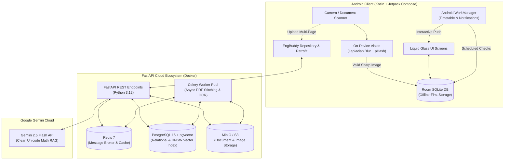
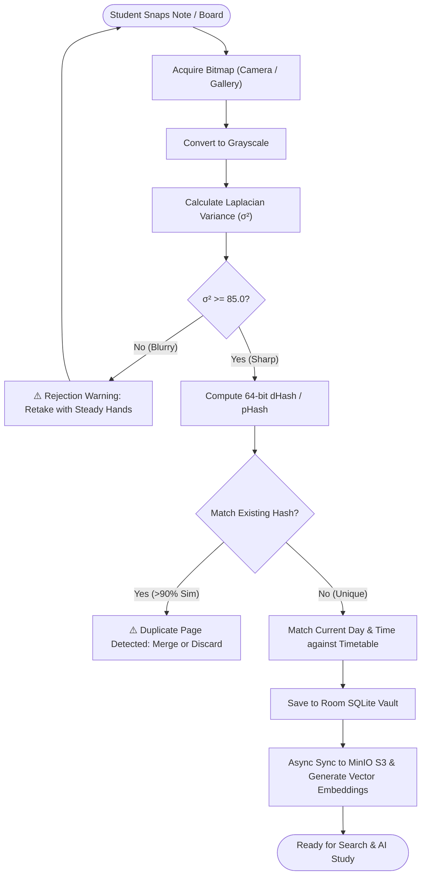
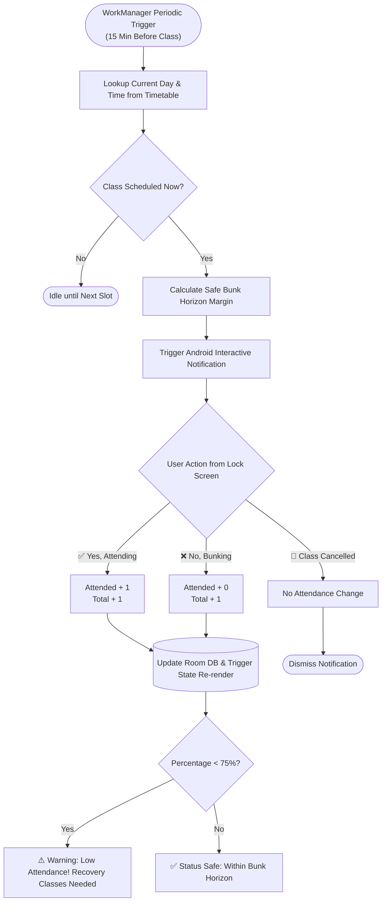
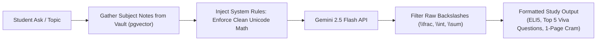

# EngBuddy (v2.0) — The Ultimate Engineering Student Companion

<div align="center">


<p align="center">
  <b>EngBuddy</b> is an AI-powered, offline-first engineering student companion engineered to eliminate the academic chaos of university life: from surviving the strict 75% attendance rule to transforming blurry lecture photos into structured revision sheets with clean mathematical notation.
</p>

[Key Features](#key-features) • [System Architecture](#system-architecture) • [Flowcharts & Workflows](#flowcharts--workflows) • [Tech Stack](#tech-stack) • [Quick Start](#quick-start) • [Join & Contribute](#join-the-project)

</div>

---

## 🌟 Key Features

### 1. 📷 Intelligent Note Vault & On-Device Computer Vision
* **Laplacian Blur Quality Gate:** Real-time variance-of-Laplacian blur calculation (`BLUR_THRESHOLD = 85.0`) on device before saving photos to ensure legible board/notebook notes.
* **Perceptual Deduplication:** Identifies and filters duplicates using 64-bit difference hashing (dHash), perceptual hashing (pHash), and SSIM comparison.
* **Timetable-Aware Auto-Filing:** Time-slotted class detection automatically routes Tuesday 10:15 AM snapshots straight into the *Thermodynamics* folder without manual tagging.
* **Smart Vault & 30-Day Recycle Bin:** Full offline storage via SQLite Room, tag search, and safe 30-day auto-purging trash retention.

### 2. 📊 Interactive "Bunk Horizon" Attendance Manager
* **Zero-Guesswork Math:** Calculates exact permissible bunks and required recovery classes to stay safely above the mandatory 75% university cutoff.
* **Actionable Notification Actions:** Background notifications via Android `WorkManager` allow students to log attendance directly from their lock screen (`[✅ Attending]`, `[❌ Bunking]`, `[🚫 Class Cancelled]`).

### 3. 🤖 Clean Unicode Math & AI Exam Crammer
* **Gemini 2.5 Flash RAG Engine:** Grounded exclusively in scanned lecture notes and syllabus outlines.
* **Zero Raw LaTeX Clutter:** Strict system prompt rules enforce human-readable UTF-8 symbols (`∫`, `∂`, `∑`, `√`, `α`, `β`, `²`) rather than raw, unrendered backslash math (`\frac{d}{dx}`).
* **High-Yield Revision Formats:** Generates ELI5 intuition, top 5 high-probability viva exam questions, and 1-page condensed exam cheat sheets.

### 4. 💳 Digital Student ID & Wallet Pass
* **Digital Pass Interface:** Apple Wallet / Google Wallet inspired student card displaying College ID, Roll Number, quick-copy actions, and scannable barcode/QR.

---

## 🏗 System Architecture

The following diagram illustrates how the Android native client, on-device vision, offline database, backend services, vector database, and Gemini AI interact:



---

## 🔄 Flowcharts & Workflows

### 1. Document Ingestion & Vision Quality Pipeline



### 2. Timetable & Interactive Bunk Horizon Engine



### 3. Clean Unicode Math & AI Exam Crammer



---

## 📐 Mathematical Formulas

The Bunk Horizon engine uses strict deterministic boundary equations:

* **Safe Bunk Capacity ($B_{\text{safe}}$):**
  $$\text{Safe Bunks} = \left\lfloor \frac{\text{Attended} - (0.75 \times \text{Total})}{0.75} \right\rfloor$$

* **Recovery Classes Required ($R_{\text{needed}}$):**
  $$\text{Classes Needed} = \left\lceil \frac{(0.75 \times \text{Total}) - \text{Attended}}{0.25} \right\rceil$$

---

## 💻 Tech Stack

| Domain | Technology / Tool | Purpose |
| :--- | :--- | :--- |
| **Native Android** | **Kotlin 2.0**, **Jetpack Compose (Material 3)** | Reactive UI with Liquid Glass styling |
| **Local Persistence** | **Android Room (SQLite)** + **KSP** | Offline-first note storage, subjects, and timetables |
| **Background Processing** | **Android WorkManager** | Timetable synchronization and lock screen notifications |
| **Cross-Platform** | **Flutter 3.4+ / Dart**, **Riverpod**, **Drift** | Multi-platform support (Desktop, iOS, Web) |
| **Backend Framework** | **FastAPI 0.115+ (Python 3.12)** | Asynchronous REST API service |
| **Relational & Vector DB**| **PostgreSQL 16** with **`pgvector`** | Note metadata and HNSW semantic embeddings |
| **Task Queue & Broker** | **Celery 5.4+** & **Redis 7** | Asynchronous background PDF assembly & processing |
| **Object Storage** | **MinIO (S3 Compatible)** | High-resolution note and document storage |
| **Generative AI** | **Google Gemini 2.5 Flash** | AI study buddy and viva question generation |
| **Computer Vision** | **OpenCV** & **NumPy** | Laplacian blur evaluation and perceptual hashing |
| **Containerization** | **Docker Compose** | One-command orchestration of the entire backend stack |

---

## 📂 Repository Structure

```
ENG-BUDDY/
├── app/                              # Native Android Application (Kotlin)
│   ├── src/main/java/com/example/
│   │   ├── core/                     # WorkManager, Notification Helpers & Receivers
│   │   ├── data/                     # Room SQLite DB, DAOs, Entities, Retrofit APIs
│   │   ├── domain/                   # AttendanceCalculator, VisionQualityPipeline
│   │   └── ui/                       # Jetpack Compose Screens, ViewModels & Themes
├── backend/                          # FastAPI Backend & Celery Worker
│   ├── app/
│   │   ├── core/                     # App settings, security, and prompt engineering
│   │   ├── db/                       # SQLAlchemy models, migrations (Alembic), seed
│   │   ├── services/                 # Computer vision & embedding pipelines
│   │   └── worker/                   # Celery asynchronous task definitions
│   ├── tests/                        # Pytest suite with 100% core test coverage
│   └── Dockerfile                    # Container configuration for backend services
├── flutter_app/                      # Cross-Platform Flutter Client
│   └── lib/                          # Flutter Riverpod & Drift architecture
├── docker-compose.yml                # Multi-container orchestration (DB, Redis, MinIO, API, Worker)
└── .env.example                      # Sample configuration variables
```

---

## 🚀 Quick Start

### 1. Running the Android Application

#### Prerequisites
* **JDK 17** or **JDK 21**
* **Android Studio** (Ladybug or newer) or Android SDK Platform 36

#### Steps
```bash
# 1. Setup local environment variables
cp .env.example .env
# Set your GEMINI_API_KEY in .env

# 2. Run unit tests
./gradlew :app:testDebugUnitTest

# 3. Install & run on your emulator or connected device
./gradlew :app:installDebug
```

---

### 2. Running Backend & Cloud Services (Docker)

Spin up PostgreSQL 16 (`pgvector`), Redis 7, MinIO S3, FastAPI, and the Celery worker with a single command:

```bash
# 1. Start all containers in the background
docker compose up -d

# 2. Seed initial engineering subjects and test user
docker compose exec backend python -m app.db.seed

# 3. Verify API health
curl http://localhost:8000/healthz
```

* **Interactive Swagger Documentation:** [http://localhost:8000/docs](http://localhost:8000/docs)
* **MinIO Object Storage Console:** [http://localhost:9001](http://localhost:9001) (`user: minioadmin`, `pass: minioadmin`)

---

## 🤝 Join the Project & Contribute!

We are actively welcoming contributors! Whether you are an Android enthusiast, backend hacker, UI/UX designer, or an engineering student with feature ideas, we’d love to have you collaborate with us.

### How to Get Started:
1. **Fork the Repository** and clone it locally.
2. **Create a Feature Branch:** `git checkout -b feature/AmazingFeature`
3. **Commit Your Changes:** `git commit -m 'feat: Add AmazingFeature'`
4. **Push to Your Branch:** `git push origin feature/AmazingFeature`
5. **Open a Pull Request** describing your work.

---

## 📄 License

Distributed under the **MIT License**. See `LICENSE` for more information.

<div align="center">
  <b>Built with ❤️ by engineering students, for engineering students.</b>
</div>
